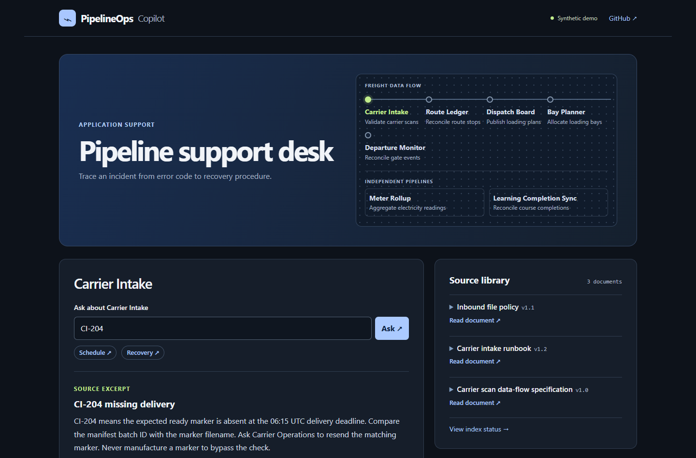
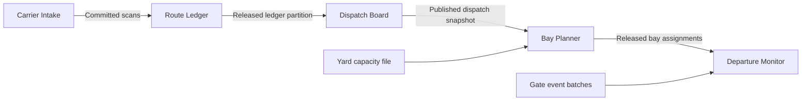
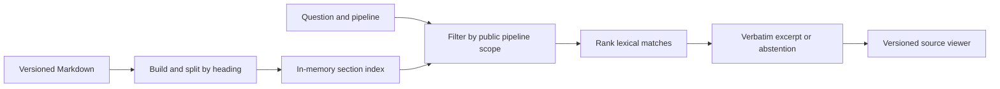

# PipelineOps Copilot

**[Open the live support desk](https://pipelineops-freight-copilot.aamansharmamu114.chatgpt.site/)**

Aman Sharma built this independent portfolio demo around a support engineer's everyday question: when a pipeline fails, which recovery procedure applies? The desk searches the selected application's documentation and cites the exact section and version. All operational data is synthetic.



## Try a one-minute investigation

### Five connected applications



Bay Planner allocates loading slots and checks for conflicting occupancy. Departure Monitor reconciles gate scans against the released bay plan. Each has a handbook, operating procedure, support agreement (DOU), architecture and data-flow specification, and troubleshooting runbook. [Investigate a bay collision](https://pipelineops-freight-copilot.aamansharmamu114.chatgpt.site/?app=bay&q=BP-307) or [trace an unmatched gate departure](https://pipelineops-freight-copilot.aamansharmamu114.chatgpt.site/?app=departure&q=GM-307).

### Independent pipelines

**Meter Rollup** reads quarter-hour electricity readings from a synthetic meter-gateway export and produces one watt-hour total per meter and UTC hour. **Learning Completion Sync** reads events from a synthetic learning-system export and reconciles the current course status per learner. Each job has its own source, output, operating schedule, support owner, incident codes, and five support guides. Both run directly from their own inputs.

From the project root, run either sample with Node.js:

```sh
node batches/run.mjs meter
node batches/run.mjs learning
```

Pass an optional JSON file as the final argument to use another export. Each job writes results to standard output after validating the full batch. The schedules described in the handbooks are reference operating schedules; the public desk provides cited support guidance. [Investigate a missing meter interval](https://pipelineops-freight-copilot.aamansharmamu114.chatgpt.site/?app=meter&q=MR-104) or [investigate a conflicting course revision](https://pipelineops-freight-copilot.aamansharmamu114.chatgpt.site/?app=learning&q=LC-409).

### Application and document permissions

The backend checks an explicit application/document allowlist before ranking sections or resolving citations. The selector, suggested incidents, source library, index status, and withdrawal notices use the caller's grants. New document IDs require an explicit grant.

| Caller | Applications and documents available |
| --- | --- |
| Anonymous visitor | Published demo documents across all seven applications |
| Gate operator demo account | Bay Planner handbook and DOU; all Departure Monitor guides, including the synthetic shift notes |

To exercise the operator account locally, supply a strong `GATE_OPERATOR_PASSWORD` through the process environment before running `npm start`. Open `/operator` and sign in with HTTP Basic username `gate`. Hosted activation requires the equivalent Worker secret and HTTPS. With no password configured the operator route returns 401. The public demo uses the anonymous scope. The optional account demonstrates server-side authorization with fictional data; the repository itself is public.

For a two-document investigation, select Dispatch Board and choose **Late release**. The desk retrieves the missed-cutoff procedure from the runbook and publication authority from the handbook. Each passage has its own versioned citation. Explicit follow-up clauses such as “and who …” are searched independently within the selected pipeline. A missing passage leaves that part marked as insufficient evidence.

1. Open [Carrier Intake's CI-204 incident](https://pipelineops-freight-copilot.aamansharmamu114.chatgpt.site/?app=intake&q=CI-204). The runbook explains why the missing ready marker matters and what the engineer should ask the carrier to resend.
2. Follow the citation beneath the excerpt. The source viewer highlights the matching section of runbook v1.2.
3. Try [the same error code under Route Ledger](https://pipelineops-freight-copilot.aamansharmamu114.chatgpt.site/?app=ledger&q=CI-204). The backend searches only that pipeline and reports insufficient evidence.

On the current 153 labeled questions, the deployed handler produced 145 expected outcomes. It declined eight supported questions and returned zero wrong citations. Run `node eval.mjs` to verify the versioned excerpt and source section for each supported answer.

### Multi-part answer evaluation

Run `npm run eval:compound` to check twenty multi-part questions across all seven applications. The suite scores each question as complete only when the part count and order match and every part passes. For supported parts it follows the versioned citation and compares the excerpt to the selected source section. For unsupported parts it requires an explicit abstention with no answer citation.

The first run passed 11/12 questions. A schedule question followed by “and can I force a restart” had been treated as one request. After recognizing that clause boundary, all 12 questions passed, including all seven mixed-evidence cases. All 14 supported parts cited the expected passage and all 11 unsupported parts abstained. After adding Bay Planner and Departure Monitor, the expanded suite verified 20/20 citations, 13/13 abstentions, and 9/9 mixed-evidence questions. With the independent pipelines, the current suite verifies 26/26 citations and 15/15 abstentions.

### Local request latency

`npm run benchmark` builds the Worker and replays the same labeled questions through its normal support-desk route. On Windows x64 with Node v24.22.1, one run recorded a median of **0.128 ms** and a **95th percentile of 0.380 ms** across 1,250 sequential requests after 125 warm-up requests. Timing starts with the constructed request and ends after reading the HTML response body. It covers local retrieval and page rendering. Network transit, cold starts, browser rendering, and source-link navigation are outside the measurement.

## Run locally

The optional browser check follows one incident in each of the seven applications from selection to the cited passage and back. With Playwright available to Node and its Chromium browser installed, run `node eval/browser-journey.cjs <origin>` against a running desk. To use installed Microsoft Edge, set `PLAYWRIGHT_CHANNEL=msedge`. It checks desktop mouse, emulated touch at two widths, and keyboard-only navigation.

Use Node.js 22 or newer. From this directory run `npm start` and open http://127.0.0.1:4173. Use `npm test` for the retrieval and route checks. Neither command requires installing packages or configuring secrets.

## First milestone



The build embeds twenty-six publicly searchable synthetic documents with fifty-seven sections in a single Fetch-compatible Worker. The anonymous demo grants access to the published documents in all seven applications. Search filters the index before ranking. Title matches carry more weight than body matches. Identifier-like terms must match, and tied scores yield an abstention. The citation viewer resolves pipeline, document, version and section. All source changes require a rebuild.

An extractive baseline makes grounding inspectable and keeps query costs independent of model tokens. Lexical overlap is an approximation of relevance. Paraphrases, negation, and questions requiring several sections need separate evaluation. There is no language model or embedding service in this milestone.

Try “What triggers this pipeline?” under both pipelines. Then search for CI-204 under each. The code appears only in Carrier Intake.

## Prioritized roadmap

### Retrieval evaluation checkpoint

Run `node eval.mjs` from this directory. The evaluation exercises the built request handler and resolves each returned citation against the source viewer. Positive cases require the expected pipeline, document, section, and verbatim excerpt. Negative cases require an explicit abstention. A nonzero exit reports at least one unmet expectation.

| Fixed question set | Original MVP | Code normalization |
| --- | --- | --- |
| Development questions | 5/8 | 8/8 |
| Held-out questions | 9/12 | 11/12 |
| Unsupported questions across both sets | 6/6 abstentions | 6/6 abstentions |

The improvement recognizes formatting variants of runbook error codes such as `CI 204` and `ci204`. The numeric suffix must match in full. The remaining held-out miss is “Any guidance for rl—410?” under Route Ledger. The code normalizes correctly, but surrounding words lower the lexical coverage below the answer threshold. These small synthetic sets characterize this release. Future tuning needs fresh held-out questions.

### Three-pipeline evaluation

Carrier Intake publishes scans to Route Ledger, which releases partitions for Dispatch Board. The board's runbook covers publication and recovery. Its handbook identifies the owner and snapshot consumers. Ask the same restart question under all three scopes or compare DB-410 under Dispatch Board with RL-410 under Route Ledger.

With retrieval rules unchanged, 17 of 18 fresh cases passed (11/12 supported, 6/6 unsupported). Every tested foreign code was rejected. The missed question, “What if an upstream release misses the morning deadline?”, produced an abstention. Across all three evaluation sets, 36/38 passed. Both misses are valid questions that received no answer. A semantic retrieval comparison should target paraphrase recall while retaining the identifier and abstention checks. These results do not measure the benefit of embeddings.

### Semantic fallback experiment

The offline candidate keeps the production lexical answer whenever one exists. On an abstention, it embeds the question with MiniLM and searches only the selected pipeline. Queries containing digits or identifier punctuation stay on the lexical path. The candidate requires cosine similarity of at least 0.40 and a lead of at least 0.08 over the runner-up. Section vectors use the heading and body, attention-mask mean pooling, and L2 normalization.

| Questions | Production lexical | Lexical with MiniLM fallback |
| --- | ---: | ---: |
| Earlier 38 | 36 correct, 2 abstentions on supported questions | 35 correct, 2 abstentions on supported questions, 1 wrong citation |
| Fresh 18 | 6 correct, 11 abstentions on supported questions, 1 wrong citation | 8 correct, 9 abstentions on supported questions, 1 wrong citation |

On the fresh questions, MiniLM recovered the downstream scan consumer and the active-writer recovery procedure. Across the earlier questions it introduced an unsupported answer about snapshot retention. Both methods cited operational ownership for an overtime-approval question. Keep the public retriever on its lexical baseline and test evidence sufficiency before revisiting deployment. This experiment evaluates section selection against manually labeled synthetic questions.

The local CPU run made 18 fallback calls with a warm median of 24.3 ms and p95 of 43.6 ms. This measures question embedding and in-scope ranking after model loading and section indexing. Hosted endpoint latency requires separate measurement.

#### Reproduce the experiment

From the project root, use Node.js 22+ and a Python 3.12 virtual environment. Install the optional benchmark dependencies with `python -m pip install -r eval/requirements.txt`. Download [tokenizer.json](https://huggingface.co/sentence-transformers/all-MiniLM-L6-v2/resolve/1110a243fdf4706b3f48f1d95db1a4f5529b4d41/tokenizer.json) and [model.onnx](https://huggingface.co/sentence-transformers/all-MiniLM-L6-v2/resolve/1110a243fdf4706b3f48f1d95db1a4f5529b4d41/onnx/model.onnx) into `.bench/model/`. Run `python eval/semantic.py`. The benchmark builds and queries the production handler for its baseline, runs embeddings locally, and reports changed decisions per question. Model files and Python packages stay outside the application bundle. [MiniLM model card](https://huggingface.co/sentence-transformers/all-MiniLM-L6-v2)

### Approval and retention evidence

The public retriever now checks recognized approval requests against the action in an approval clause. For retention-period requests, the section must explicitly connect the requested item with a retention expression and duration. Ambiguous matches abstain. These conservative lexical rules cover common wording; paraphrase coverage remains limited.

The original Carrier Intake policy specified 14 days for inbound manifests. Revision 1.1 extends retention to 21 days after batch commitment. Dispatch Board has no documented snapshot retention period. Try both questions and follow the intake citation.

On the same five-document corpus, the original lexical baseline scored 51/68, including four wrong citations. The added checks scored 55/68 with zero wrong citations and thirteen supported questions unanswered. All twelve targeted cases passed, including four valid answers and eight abstentions. The optional local semantic experiment also respects these checks and scored 57/68 with zero wrong citations. The deployed application uses the lexical implementation. Counts describe the labeled fixtures only.

### Carrier Intake validation coverage

The Carrier scan data-flow specification covers staging, the CI-422 count mismatch, and duplicate scan identifiers. Seven additional citation and isolation checks passed. Across 75 labeled questions the lexical retriever produced 62 correct outcomes, with 13 supported questions unanswered.

### Schedule question evaluation

For “how often” and “how frequently” questions, retrieval checks for a recurring interval in the source. An unqualified question uses the selected pipeline’s schedule. Named jobs and qualifiers must match evidence in the same sentence. On twelve schedule fixtures, the lexical baseline answered one of six supported questions and declined all six unsupported ones. The added check answered all six supported cases and preserved all six abstentions. Overall, 74 of 87 labeled questions passed. The remaining thirteen supported questions received no answer.

### Active-writer recovery

The writer-recovery evaluation covers concurrent writes, foreign job identifiers, forced restarts, and writer termination. The lexical baseline scored 6/10 on these questions. Requiring evidence for the requested action raised the result to 10/10 and recovered one earlier paraphrase. Across 97 labeled questions, 85 produced the expected result and 12 supported questions received no answer.

### Conversational incident lookup

The incident lookup evaluation covers ordinary questions around an exact code, including “Any guidance for RL‑410?”. Lookup framing is removed only when one code remains. On ten targeted questions, retrieval improved from 5/10 to 10/10. Across 107 labeled questions, 96 produced the expected citation or abstention and eleven supported questions received no answer.

### Delivery deadlines

Dispatch Board runbook v1.1 documents the upstream release boundary, the 08:05 UTC cutoff, and the snapshot to keep visible. Deadline and cutoff lookups require a time in the selected section and evidence for the requested qualifiers. Eight targeted cases passed, up from four on the prior release. Across 115 labeled questions, 105 produced the expected outcome and ten supported questions received no answer.

### Approval action wording

The approval-action evaluation compares manual publication and stop-ID correction with unsupported requests such as automatic publication or deleting a stop. Dispatch Board handbook v1.1 explicitly identifies the board as the object of manual publication. On ten targeted questions, the prior release scored 7/10 and this release scored 10/10. Across 125 labeled questions, 117 produced the expected citation or abstention. Eight supported questions remained unanswered.

### Build-time version synchronization

The Markdown repository keeps the initial file at `docs/<pipeline>/<id>.md`. Add a revision alongside it as `<id>@<major>.<minor>.md` with a matching `Version` header. Run `npm run build` to refresh the local Worker bundle. Each build reads the repository and selects the highest numeric version per pipeline and document ID. Older text stays in the source repository. Only the current revision enters the deployed index and source viewer. A superseded citation returns HTTP 404.

The build validates all revisions before replacing the Worker bundle with a same-directory rename. The synchronization regression exercises an update, repeat build, malformed revision, and withdrawal against a temporary repository. Publishing still requires a release.

Each build scans and hashes the Markdown source files. It reuses previously parsed sections when the source path, content hash, and parser fingerprint match. Run `npm run build` twice to see parsed and reused counts. Deleted files drop out of the next catalog. The ignored local `.sync-cache/` directory stores parsed revisions and can be removed for a cold build. Deployment still builds a complete Worker bundle and initializes the live search index from current sections.

### Follow a withdrawn citation

Open **View index status** from a pipeline's source library to inspect deployed document versions, searchable section counts, and withdrawals. Each document link opens the current source or the retirement notice. [Dispatch Board index status](https://pipelineops-freight-copilot.aamansharmamu114.chatgpt.site/index-status?app=dispatch)

The synthetic Dispatch Board repository includes a retired manual handoff guide. Open its [former citation](https://pipelineops-freight-copilot.aamansharmamu114.chatgpt.site/source?app=dispatch&doc=handoff&v=1.0) to see the withdrawal notice and a link to current sources. [Search for its former error code](https://pipelineops-freight-copilot.aamansharmamu114.chatgpt.site/?app=dispatch&q=DH-118) to verify the old procedure is unavailable.

To retire a document, add a higher revision with the same ID. Include the title and version header, followed by `Status retired` on its own line, and omit all sections. At build time the highest revision wins. Retirement publishes only identifying metadata, excludes all historical text from retrieval, and returns HTTP 410 for known revisions in that pipeline. Unknown versions and other pipeline scopes return 404.

| Phase | Deliverable | Exit check |
| --- | --- | --- |
| 1. Source-backed lookup | Server-scoped search, abstention, linked viewer | Every positive fixture opens the exact quoted passage. Foreign-code and unknown-scope fixtures pass. |
| 2. Retrieval accuracy | Add a third pipeline and overlapping documents. Label a held-out set of paraphrases, identifiers, unsupported questions and multi-section procedures. Compare lexical and semantic retrieval. | Record recall at k, citation correctness, abstention errors and latency. Review failures before choosing a model. |
| 3. Synchronization | Mock repository connector with stable IDs, versions, hashes, retirement and atomic index replacement | Replay a change feed twice. Check that updates replace old passages, retirement removes evidence and a failed import preserves the last good index. |
| 4. Operator experience | Improve source navigation, mobile layout and keyboard interaction using tested support scenarios | Complete a recovery lookup and verify its source on desktop and mobile. |
| 5. Advanced assistance | Evaluate grounded synthesis for multi-source questions; add usage controls before enabling a paid endpoint | Reject unsupported claims and measure cost and latency against the extractive baseline. |
| 6. Public release | Confirm anonymous hosting access, add release checks and prepare portfolio materials from measured results | Open a live URL signed out, perform a query and verify its citation. |

## Implementation references

The same Fetch handler serves local requests through a small Node adapter and builds to `dist/server/index.js` for Worker hosting. [Worker Fetch handler](https://developers.cloudflare.com/workers/runtime-apis/handlers/fetch/)

Tests use the built-in runner and execute the built handler. [Node test runner](https://nodejs.org/api/test.html)
