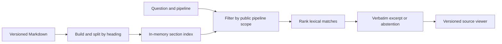

# PipelineOps Copilot

A read-only support desk for a fictional freight platform. Ask a question about Carrier Intake or Route Ledger and follow the cited excerpt to the versioned runbook section.

## Run locally

Use Node.js 22 or newer. From this directory run `npm start` and open http://127.0.0.1:4173. Use `npm test` for the retrieval and route checks. Neither command requires installing packages or configuring secrets.

## First milestone

The build embeds two synthetic documents with eight sections in a single Fetch-compatible Worker. Both pipelines are public demo scopes. Search filters the index before ranking. Title matches carry more weight than body matches. Identifier-like terms must match, and tied scores yield an abstention. The citation viewer resolves pipeline, document, version and section. All source changes require a rebuild.

An extractive baseline makes grounding inspectable and keeps query costs independent of model tokens. Lexical overlap is an approximation of relevance. Paraphrases, negation, and questions requiring several sections need separate evaluation. There is no language model or embedding service in this milestone.

Try “What triggers this pipeline?” under both pipelines. Then search for CI-204 under each. The code appears only in Carrier Intake.

## Prioritized roadmap

| Phase | Deliverable | Exit check |
| --- | --- | --- |
| 1. Source-backed lookup | Server-scoped search, abstention, linked viewer | Every positive fixture opens the exact quoted passage. Foreign-code and unknown-scope fixtures pass. |
| 2. Retrieval accuracy | Add a third pipeline and overlapping documents. Label a held-out set of paraphrases, identifiers, unsupported questions and multi-section procedures. Compare lexical and semantic retrieval. | Record recall at k, citation correctness, abstention errors and latency. Review failures before choosing a model. |
| 3. Synchronization | Mock repository connector with stable IDs, versions, hashes, retirement and atomic index replacement | Replay a change feed twice. Check that updates replace old passages, retirement removes evidence and a failed import preserves the last good index. |
| 4. Operator experience | Improve source navigation, mobile layout and keyboard interaction using tested support scenarios | Complete a recovery lookup and verify its source on desktop and mobile. |
| 5. Advanced assistance | Evaluate grounded synthesis for multi-source questions; add usage controls before enabling a paid endpoint | Reject unsupported claims and measure cost and latency against the extractive baseline. |
| 6. Public release | Confirm anonymous hosting access, add release checks and prepare portfolio materials from measured results | Open a live URL signed out, perform a query and verify its citation. |

## Implementation references

The same Fetch handler serves local requests through a small Node adapter and builds to `dist/server/index.js` for Worker hosting. [Worker Fetch handler](https://developers.cloudflare.com/workers/runtime-apis/handlers/fetch/)

Tests use the built-in runner and execute the built handler. [Node test runner](https://nodejs.org/api/test.html)
