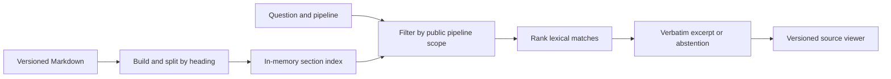

# PipelineOps Copilot

A read-only support desk for a fictional freight platform. Ask a question about Carrier Intake, Route Ledger, or Dispatch Board and follow the cited excerpt to the versioned runbook section.

## Run locally

Use Node.js 22 or newer. From this directory run `npm start` and open http://127.0.0.1:4173. Use `npm test` for the retrieval and route checks. Neither command requires installing packages or configuring secrets.

## First milestone

The build embeds four synthetic documents with thirteen sections in a single Fetch-compatible Worker. All three pipelines are public demo scopes. Search filters the index before ranking. Title matches carry more weight than body matches. Identifier-like terms must match, and tied scores yield an abstention. The citation viewer resolves pipeline, document, version and section. All source changes require a rebuild.

An extractive baseline makes grounding inspectable and keeps query costs independent of model tokens. Lexical overlap is an approximation of relevance. Paraphrases, negation, and questions requiring several sections need separate evaluation. There is no language model or embedding service in this milestone.

Try “What triggers this pipeline?” under both pipelines. Then search for CI-204 under each. The code appears only in Carrier Intake.

## Prioritized roadmap

### Retrieval evaluation checkpoint

Run `node eval.mjs` from this directory. The evaluation exercises the built request handler and resolves each returned citation against the source viewer. Positive cases require the expected pipeline, document, section, and verbatim excerpt. Negative cases require an explicit abstention. A nonzero exit reports at least one unmet expectation.

| Fixed question set | Original MVP | Code normalization |
| --- | --- | --- |
| Development questions | 5/8 | 8/8 |
| Held-out questions | 9/12 | 11/12 |
| Unsupported questions across both sets | 6/6 abstentions | 6/6 abstentions |

The improvement recognizes formatting variants of runbook error codes such as `CI 204` and `ci204`. The numeric suffix must match in full. The remaining held-out miss is “Any guidance for rl—410?” under Route Ledger. The code normalizes correctly, but surrounding words lower the lexical coverage below the answer threshold. These small synthetic sets characterize this release. Future tuning needs fresh held-out questions.

### Three-pipeline evaluation

Carrier Intake publishes scans to Route Ledger, which releases partitions for Dispatch Board. The board's runbook covers publication and recovery. Its handbook identifies the owner and snapshot consumers. Ask the same restart question under all three scopes or compare DB-410 under Dispatch Board with RL-410 under Route Ledger.

With retrieval rules unchanged, 17 of 18 fresh cases passed (11/12 supported, 6/6 unsupported). Every tested foreign code was rejected. The missed question, “What if an upstream release misses the morning deadline?”, produced an abstention. Across all three evaluation sets, 36/38 passed. Both misses are valid questions that received no answer. A semantic retrieval comparison should target paraphrase recall while retaining the identifier and abstention checks. These results do not measure the benefit of embeddings.

| Phase | Deliverable | Exit check |
| --- | --- | --- |
| 1. Source-backed lookup | Server-scoped search, abstention, linked viewer | Every positive fixture opens the exact quoted passage. Foreign-code and unknown-scope fixtures pass. |
| 2. Retrieval accuracy | Add a third pipeline and overlapping documents. Label a held-out set of paraphrases, identifiers, unsupported questions and multi-section procedures. Compare lexical and semantic retrieval. | Record recall at k, citation correctness, abstention errors and latency. Review failures before choosing a model. |
| 3. Synchronization | Mock repository connector with stable IDs, versions, hashes, retirement and atomic index replacement | Replay a change feed twice. Check that updates replace old passages, retirement removes evidence and a failed import preserves the last good index. |
| 4. Operator experience | Improve source navigation, mobile layout and keyboard interaction using tested support scenarios | Complete a recovery lookup and verify its source on desktop and mobile. |
| 5. Advanced assistance | Evaluate grounded synthesis for multi-source questions; add usage controls before enabling a paid endpoint | Reject unsupported claims and measure cost and latency against the extractive baseline. |
| 6. Public release | Confirm anonymous hosting access, add release checks and prepare portfolio materials from measured results | Open a live URL signed out, perform a query and verify its citation. |

## Implementation references

The same Fetch handler serves local requests through a small Node adapter and builds to `dist/server/index.js` for Worker hosting. [Worker Fetch handler](https://developers.cloudflare.com/workers/runtime-apis/handlers/fetch/)

Tests use the built-in runner and execute the built handler. [Node test runner](https://nodejs.org/api/test.html)
