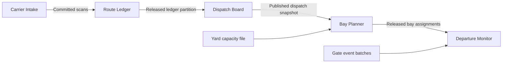

# Engineering guide

### Five connected applications



Bay Planner allocates loading slots and checks for conflicting occupancy. Departure Monitor reconciles gate scans against the released bay plan. Each has a handbook, operating procedure, support agreement (DOU), architecture and data-flow specification, and troubleshooting runbook. [Investigate a bay collision](https://pipelineops-freight-copilot.aamansharmamu114.chatgpt.site/?app=bay&q=BP-307) or [trace an unmatched gate departure](https://pipelineops-freight-copilot.aamansharmamu114.chatgpt.site/?app=departure&q=GM-307).

### Independent pipelines

**Meter Rollup** reads quarter-hour electricity readings from a synthetic meter-gateway export and produces one watt-hour total per meter and UTC hour. **Learning Completion Sync** reads events from a synthetic learning-system export and reconciles the current course status per learner. Each job has its own source, output, operating schedule, support owner, incident codes, and five support guides. Water Quality Monitor validates a sealed sensor export for complete sample sequences and consistent calibration, then reports the observed turbidity range. All three run from independent inputs.

From the project root, run either sample with Node.js:

```sh
node batches/run.mjs meter
node batches/run.mjs learning
node batches/run.mjs water
```

Pass an optional JSON file as the final argument to use another export. Each job writes results to standard output after validating the full batch. The schedules described in the handbooks are reference operating schedules; the public desk provides cited support guidance. [Investigate a missing meter interval](https://pipelineops-freight-copilot.aamansharmamu114.chatgpt.site/?app=meter&q=MR-104) or [investigate a conflicting course revision](https://pipelineops-freight-copilot.aamansharmamu114.chatgpt.site/?app=learning&q=LC-409).

### Application and document permissions

The backend checks an explicit application/document allowlist before ranking sections or resolving citations. The selector, suggested incidents, source library, index status, and withdrawal notices use the caller's grants. New document IDs require an explicit grant.

| Caller | Applications and documents available |
| --- | --- |
| Anonymous visitor | Published demo documents across all eight applications |
| Gate operator demo account | Bay Planner handbook and DOU; all Departure Monitor guides, including the synthetic shift notes |

To exercise the operator account locally, supply a strong `GATE_OPERATOR_PASSWORD` through the process environment before running `npm start`. Open `/operator` and sign in with HTTP Basic username `gate`. Hosted activation requires the equivalent Worker secret and HTTPS. With no password configured the operator route returns 401. The public demo uses the anonymous scope. The optional account demonstrates server-side authorization with fictional data; the repository itself is public.

### Build-time version synchronization

The Markdown repository keeps the initial file at `docs/<pipeline>/<id>.md`. Add a revision alongside it as `<id>@<major>.<minor>.md` with a matching `Version` header. Run `npm run build` to refresh the local Worker bundle. Each build reads the repository and selects the highest numeric version per pipeline and document ID. Older text stays in the source repository. Only the current revision enters the deployed index and source viewer. A superseded citation returns HTTP 404.

The build validates all revisions before replacing the Worker bundle with a same-directory rename. The synchronization regression exercises an update, repeat build, malformed revision, and withdrawal against a temporary repository. Publishing still requires a release.

Each build scans and hashes the Markdown source files. It reuses previously parsed sections when the source path, content hash, and parser fingerprint match. Run `npm run build` twice to see parsed and reused counts. Deleted files drop out of the next catalog. The ignored local `.sync-cache/` directory stores parsed revisions and can be removed for a cold build. Deployment still builds a complete Worker bundle and initializes the live search index from current sections.

### Follow a withdrawn citation

Open **View index status** from a pipeline's source library to inspect deployed document versions, searchable section counts, and withdrawals. Each document link opens the current source or the retirement notice. [Dispatch Board index status](https://pipelineops-freight-copilot.aamansharmamu114.chatgpt.site/index-status?app=dispatch)

The synthetic Dispatch Board repository includes a retired manual handoff guide. Open its [former citation](https://pipelineops-freight-copilot.aamansharmamu114.chatgpt.site/source?app=dispatch&doc=handoff&v=1.0) to see the withdrawal notice and a link to current sources. [Search for its former error code](https://pipelineops-freight-copilot.aamansharmamu114.chatgpt.site/?app=dispatch&q=DH-118) to verify the old procedure is unavailable.

To retire a document, add a higher revision with the same ID. Include the title and version header, followed by `Status retired` on its own line, and omit all sections. At build time the highest revision wins. Retirement publishes only identifying metadata, excludes all historical text from retrieval, and returns HTTP 410 for known revisions in that pipeline. Unknown versions and other pipeline scopes return 404.

### Semantic fallback experiment

The offline candidate keeps the production lexical answer whenever one exists. On an abstention, it embeds the question with MiniLM and searches only the selected pipeline. Queries containing digits or identifier punctuation stay on the lexical path. The candidate requires cosine similarity of at least 0.40 and a lead of at least 0.08 over the runner-up. Section vectors use the heading and body, attention-mask mean pooling, and L2 normalization.

| Questions | Production lexical | Lexical with MiniLM fallback |
| --- | ---: | ---: |
| Earlier 38 | 36 correct, 2 abstentions on supported questions | 35 correct, 2 abstentions on supported questions, 1 wrong citation |
| Fresh 18 | 6 correct, 11 abstentions on supported questions, 1 wrong citation | 8 correct, 9 abstentions on supported questions, 1 wrong citation |

On the fresh questions, MiniLM recovered the downstream scan consumer and the active-writer recovery procedure. Across the earlier questions it introduced an unsupported answer about snapshot retention. Both methods cited operational ownership for an overtime-approval question. Keep the public retriever on its lexical baseline and test evidence sufficiency before revisiting deployment. This experiment evaluates section selection against manually labeled synthetic questions.

The local CPU run made 18 fallback calls with a warm median of 24.3 ms and p95 of 43.6 ms. This measures question embedding and in-scope ranking after model loading and section indexing. Hosted endpoint latency requires separate measurement.

#### Reproduce the experiment

From the project root, use Node.js 22+ and a Python 3.12 virtual environment. Install the optional benchmark dependencies with `python -m pip install -r eval/requirements.txt`. Download [tokenizer.json](https://huggingface.co/sentence-transformers/all-MiniLM-L6-v2/resolve/1110a243fdf4706b3f48f1d95db1a4f5529b4d41/tokenizer.json) and [model.onnx](https://huggingface.co/sentence-transformers/all-MiniLM-L6-v2/resolve/1110a243fdf4706b3f48f1d95db1a4f5529b4d41/onnx/model.onnx) into `.bench/model/`. Run `python eval/semantic.py`. The benchmark builds and queries the production handler for its baseline, runs embeddings locally, and reports changed decisions per question. Model files and Python packages stay outside the application bundle. [MiniLM model card](https://huggingface.co/sentence-transformers/all-MiniLM-L6-v2)

### Local request latency

`npm run benchmark` builds the Worker and replays the same labeled questions through its normal support-desk route. On Windows x64 with Node v24.22.1, one run recorded a median of **0.128 ms** and a **95th percentile of 0.380 ms** across 1,250 sequential requests after 125 warm-up requests. Timing starts with the constructed request and ends after reading the HTML response body. It covers local retrieval and page rendering. Network transit, cold starts, browser rendering, and source-link navigation are outside the measurement.

The optional browser check follows one incident in each of the eight applications from selection to the cited passage and back. With Playwright available to Node and its Chromium browser installed, run `node eval/browser-journey.cjs <origin>` against a running desk. To use installed Microsoft Edge, set `PLAYWRIGHT_CHANNEL=msedge`. It checks desktop mouse, emulated touch at two widths, and keyboard-only navigation.
